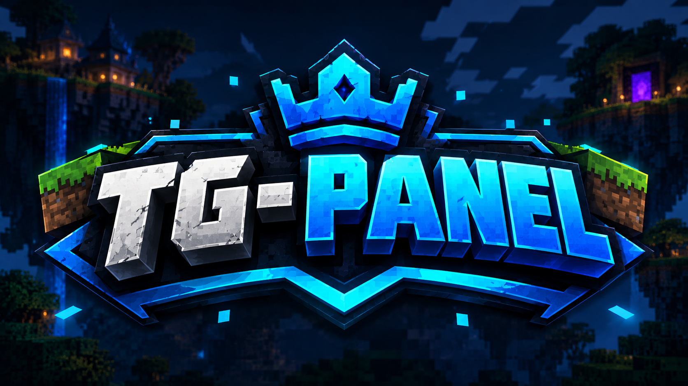
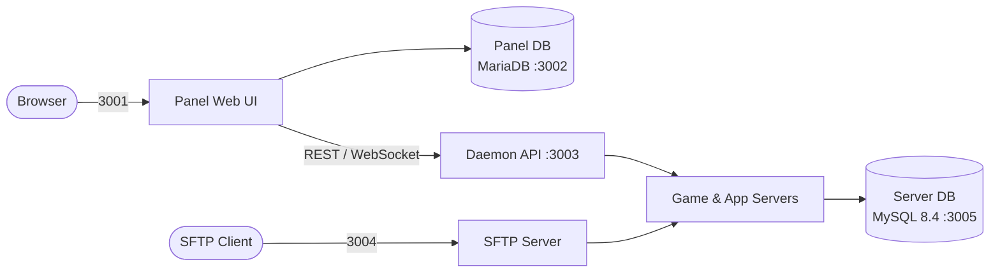

<p align="center">
  
</p>

<p align="center">
  
</p>

<h1 align="center">TG-PANEL</h1>

<p align="center">
  <b>A fast, self-hosted web panel for managing game & application servers.</b><br/>
  Live console · Built-in SFTP · REST & WebSocket API
</p>

<p align="center">
  <a href="https://nodejs.org"></a>
  <a href="https://github.com/ShadowGamerIND37/TGPANEL/releases"></a>
  <a href="LICENSE"></a>
  <a href="https://tgpanel.in"></a>
</p>

<p align="center">
  <a href="#-features">Features</a> ·
  <a href="#-quick-start">Quick Start</a> ·
  <a href="#-architecture">Architecture</a> ·
  <a href="#-sftp-access">SFTP</a> ·
  <a href="#-security-checklist">Security</a> ·
  <a href="#-troubleshooting">Troubleshooting</a> ·
  <a href="#-contributing">Contributing</a>
</p>

---

<!-- TODO: add a real screenshot or GIF of the dashboard -->
<!--
<p align="center">
  
</p>
-->

## ✨ Features

| | |
| :--- | :--- |
| 🖥️ **Live console** | Real-time server output and commands over WebSocket |
| 📁 **Built-in SFTP** | Per-server file access with your panel credentials, no extra setup |
| 🔌 **Daemon API** | REST and WebSocket API for automation and integrations |
| 🗄️ **Separate databases** | MariaDB for the panel, MySQL 8.4 for game servers |
| 🧰 **Management menu** | One script to install, update, and maintain the panel |

<!-- TODO: add or remove rows to match what the panel actually supports -->

---

## 🚀 Quick Start

### Requirements

- Linux server (Ubuntu 22.04+ / Debian 12+ recommended) <!-- TODO: confirm supported distros -->
- Node.js 18 or newer
- Git
- Root or `sudo` access <!-- TODO: confirm -->

### Install

```bash
git clone https://github.com/ShadowGamerIND37/TGPANEL
cd TGPANEL
bash menu.sh
```

Follow the prompts in the menu. When it finishes, open the panel at:

```
http://<your-server-ip>:3001
```

### Reopen the management menu

```bash
cd TGPANEL
./menu.sh
```

---

## 🔑 First Login

| Field | Value |
| :--- | :--- |
| **URL** | `http://localhost:3001` |
| **Username** | `admin` |
| **Password** | `admin` |

> [!WARNING]
> These are default credentials. **Change the password immediately after your first login.**

---

## 🏗️ Architecture



<!-- TODO: verify the connections above match how the components actually talk to each other -->

### Ports

| Service | Port | Description | Expose publicly? |
| :--- | :---: | :--- | :---: |
| **Panel Web UI** | `3001` | Dashboard and live console | ✅ Yes (behind HTTPS) |
| **Panel DB (MariaDB)** | `3002` | Panel internal database | ❌ No |
| **Daemon API** | `3003` | REST and WebSocket API | ⚠️ Only if needed |
| **SFTP Server** | `3004` | Built-in SFTP | ✅ If you use SFTP |
| **Server DB (MySQL 8.4)** | `3005` | Game servers database | ❌ No |

---

## 📁 SFTP Access

| Field | Value |
| :--- | :--- |
| **Host** | `localhost` or your server IP |
| **Port** | `3004` |
| **Username** | `admin.<server_id>` (for example `admin.1`) |
| **Password** | Your TG-PANEL account password |

```bash
sftp -P 3004 admin.1@your-server-ip
```

Or connect with a client like FileZilla or WinSCP using `sftp://your-server-ip:3004`.

---

## 🛡️ Security Checklist

- [ ] Change the default `admin` / `admin` login
- [ ] Block database ports `3002` and `3005` from the public internet
- [ ] Serve the panel over HTTPS using a reverse proxy (Nginx or Caddy)
- [ ] Keep the panel updated to the latest release

<details>
<summary><b>Example firewall setup (UFW)</b></summary>

```bash
sudo ufw default deny incoming
sudo ufw allow 22/tcp      # SSH
sudo ufw allow 3001/tcp    # Panel (or 80/443 if using a reverse proxy)
sudo ufw allow 3004/tcp    # SFTP
sudo ufw enable
```

Database ports `3002` and `3005` stay closed, so only local services can reach them.

</details>

<details>
<summary><b>Example Nginx reverse proxy</b></summary>

```nginx
server {
    listen 80;
    server_name panel.example.com;

    location / {
        proxy_pass http://127.0.0.1:3001;
        proxy_http_version 1.1;
        proxy_set_header Upgrade $http_upgrade;
        proxy_set_header Connection "upgrade";
        proxy_set_header Host $host;
        proxy_set_header X-Real-IP $remote_addr;
    }
}
```

The `Upgrade` headers are required for the live console (WebSocket) to work. Add HTTPS with [Certbot](https://certbot.eff.org/).

</details>

---

## 🩺 Troubleshooting

<details>
<summary><b>Can't reach the panel on port 3001</b></summary>

- Check that the panel is running from the management menu.
- Make sure your firewall or cloud provider's security group allows port `3001`.
- If you're on a remote server, use the server IP instead of `localhost`.

</details>

<details>
<summary><b>Live console doesn't update behind a reverse proxy</b></summary>

Your proxy must forward WebSocket connections. See the Nginx example above.

</details>

<details>
<summary><b>SFTP login fails</b></summary>

- Use the format `admin.<server_id>`, not just `admin`.
- The password is your panel account password.
- Confirm port `3004` is open and you're connecting with `-P 3004` (capital P for `sftp`).

</details>

<details>
<summary><b>Node.js version errors</b></summary>

Run `node -v`. If it's below 18, upgrade Node.js and run the menu again.

</details>

---

## 🤝 Contributing

Contributions are welcome.

1. Fork the repository
2. Create a branch: `git checkout -b feature/my-change`
3. Commit your changes: `git commit -m "Add my change"`
4. Push and open a pull request

Found a bug or have an idea? [Open an issue](https://github.com/ShadowGamerIND37/TGPANEL/issues).

---

## 👨‍💻 Credits

- **Developer:** [ShadowGamerIND](https://discord.com/users/924366651443527710)
- **Website:** [tgpanel.in](https://tgpanel.in)
- **License:** [MIT](LICENSE)

<p align="center">
  <sub>Made with ❤️ for the game hosting community</sub>
</p>
