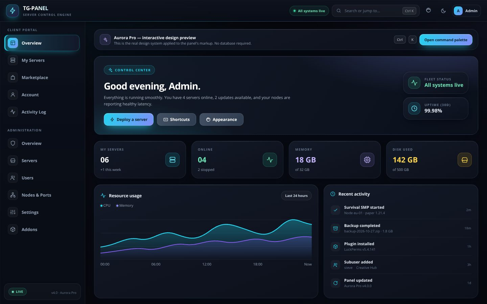

# Aurora Pro — UI / UX upgrade

> Version 4.0.0 of the TG-PANEL front-end layer. Additive, reversible, and
> compatible with every existing theme.



---

## 1. What was added

### Visual system — `public/css/premium.css`

A single, coherent design language loaded **last**, after `style.css` and all
theme stylesheets, so it refines every built-in theme without deleting any of
them.

| Area | What changed |
| --- | --- |
| Tokens | Central colour, radius, shadow, typography, motion and spacing variables. Five accent palettes (cyan, violet, emerald, amber, rose). |
| Typography | Plus Jakarta Sans for headings, Inter for UI, JetBrains Mono for metrics/console. Fluid heading scale and tighter tracking. |
| Background | Layered ambient gradient mesh + subtle grid; wallpaper is dimmed to 26% by default and adjustable. |
| Topbar | 64px glass bar, gradient wordmark, refined icon buttons, search pill, connection status. |
| Sidebar | 252px frosted rail, 40px nav rows, gradient active pill with a left accent bar, uppercase section labels. |
| Cards | Hairline borders, top highlight, layered shadows, 20px radii and a gentle lift on hover. |
| Controls | Unified primary/secondary/danger buttons, consistent inputs with focus rings, custom select arrow, tables, modals, badges, toasts. |
| Terminal | Darker console surface, mono type, styled prompt bar. |
| Modes | Dark (default), Daylight (light), Compact density, Focus mode, Reduced motion, Classic styling (full rollback switch). |
| Responsive | Mobile drawer support, safe-area friendly spacing, fluid grids, touch-friendly hit targets. |
| Accessibility | Visible focus rings, skip link, `aria-live` region, `aria-current` on navigation, dialog roles, zoom allowed, reduced-motion support. |

### UX engine — `public/js/ux.js`

Zero dependencies. It wraps existing controllers rather than replacing them.

- **Command palette** (`Ctrl/⌘ + K` or `/`): fuzzy search across every sidebar
  page, your servers, recent views and panel actions. Arrow keys + Enter.
- **Appearance popover** (palette icon in the header): colour mode, 5 accents,
  density, wallpaper intensity, animations, focus mode, premium styling toggle,
  reset to defaults. Everything persists in `localStorage`.
- **Keyboard shortcuts** (`?` opens the full cheat sheet).
- **Global search affordance** in the topbar, with live online status pill.
- **View transitions**, automatic scroll-to-top, per-page document titles,
  recent-page history, active-nav sync.
- **Top progress bar** on `/api/*` requests, so slow calls never look frozen.
- **Icon hydration**: a `MutationObserver` renders Lucide icons after every
  AJAX view swap; if the Lucide CDN is blocked, an inline icon set takes over.
- **Form polish**: password visibility toggles, auto-growing textareas,
  accessible names on icon-only buttons, horizontal scroll wrappers for tables.
- **Scroll-to-top FAB**, online/offline banner, friendly network error toast,
  first-run tip.

### Server-side fixes — `src/index.js`

- Unknown `/api/*` routes now return a JSON 404 instead of **hanging forever**
  (the old SPA fallback simply never answered those requests).
- Added `GET /api/health` for uptime monitors and reverse proxies.
- Added a final error handler so API failures return JSON, not an empty reply.
- Baseline security headers (`nosniff`, `Referrer-Policy`,
  `Permissions-Policy`), disabled `X-Powered-By`.
- Static assets are cached smartly: HTML/JS/CSS stay `no-cache` so updates land
  immediately, while images/fonts are cached for a day.
- `X-Frame-Options` is deliberately **not** set, so embedding behind a proxy or
  preview iframe still works.

### Other fixes

- `public/index.html`: removed a literal, unexpanded `${Date.now()}` in the
  logo `src`; fixed the infinite `onerror` reload loop on a missing logo;
  replaced the leftover `Angelillo15` brand with `TG-PANEL`; allowed pinch zoom
  for accessibility; added description/theme-colour meta, `<noscript>`, and a
  `header-actions` hook.
- New fonts loaded: Plus Jakarta Sans, Inter (expanded weights), JetBrains Mono.

---

## 2. Try it without a database

```bash
npm run preview
# open http://localhost:4173
```

`bin/preview.js` is a tiny zero-dependency static server that serves
`public/preview.html` — a fully interactive showcase using the same classes,
CSS and UX engine as the real panel. No MariaDB, no daemon, no CDN required.

Set a different port with `PORT_PREVIEW=5000 npm run preview`.

---

## 3. Keyboard shortcuts

| Shortcut | Action |
| --- | --- |
| `Ctrl/⌘ + K` | Open / close command palette |
| `/` | Open command palette |
| `?` | Keyboard shortcut cheat sheet |
| `Ctrl/⌘ + Shift + P` | Appearance settings |
| `Ctrl/⌘ + /` | Keyboard shortcut cheat sheet |
| `T` | Toggle dark / light mode |
| `G` then `O` | Overview |
| `G` then `S` | My servers |
| `G` then `C` | Current server console |
| `G` then `F` | Current server files |
| `G` then `A` | Admin overview |
| `G` then `P` | Account profile |
| `G` then `M` | Marketplace |
| `G` then `L` | Activity log |
| `Esc` | Close palette / help / appearance / modal |

Shortcuts never fire while you are typing in a field.

---

## 4. Appearance options

Open the palette icon in the topbar (or run `TGUX.openAppearance()` in DevTools).

| Setting | Values | Default |
| --- | --- | --- |
| Colour mode | `Panel` (respects admin `theme_mode`), `Dark`, `Light` | Panel |
| Accent | cyan, violet, emerald, amber, rose | cyan |
| Density | comfortable, compact | comfortable |
| Wallpaper intensity | 0–80% | 26% |
| Animations | on / off | on |
| Focus mode | hides the wallpaper | off |
| Premium styling | on / off (off = exact classic look) | on |

Preferences live under `localStorage['tgpanel_ux_prefs_v4']`.

---

## 5. Developer API

```js
TGUX.openPalette('server');          // open with a pre-filled query
TGUX.closePalette();
TGUX.openAppearance();
TGUX.openHelp();
TGUX.setPref('accent', 'violet');
TGUX.resetPrefs();
TGUX.toast('Saved', 'success');

// Add your own command to the palette:
TGUX.registerCommand({
  label: 'Purge cache',
  hint: 'Clear the panel cache',
  group: 'Actions',
  icon: 'refresh',
  keywords: 'cache clean purge',
  run: () => fetch('/api/admin/cache', { method: 'DELETE' })
});
```

Helper classes available to views: `.ux-skeleton` (shimmer placeholder),
`.ux-sr-only`, `.ux-fab`, `.ux-progress`, plus all CSS custom properties
(`--ux-accent`, `--ux-radius`, `--ux-shadow`, …).

---

## 6. Disabling / rolling back

- **Per user:** Appearance → turn off *Premium styling*. This disables
  `premium.css` (`link.disabled = true`) without a reload.
- **Per deployment:** remove the `<link id="ux-premium-css" …>` line and the
  `<script src="/js/ux.js …">` line from `public/index.html`. Everything else
  keeps working — no controller depends on either file.
- The UX engine is defensive: if `app`, `auth` or Lucide are missing, it skips
  the relevant integration instead of throwing.

---

## 7. Compatibility notes

- `premium.css` intentionally uses high-specificity selectors and `!important`
  on a handful of properties because Tailwind Play CDN injects its stylesheet
  at runtime, after all `<link>` tags.
- xterm.js and Ace editor helper inputs/textareas are explicitly excluded from
  the global form styling so the console and code editor stay untouched.
- Light mode is a best-effort inversion of historically dark markup. Buttons,
  gradient surfaces and status colours keep their own contrast. If you ship a
  custom theme, test it with `html.light` applied.
- The design layer does not add runtime dependencies. Fonts come from Google
  Fonts with a system-font fallback; icons fall back to the bundled inline set.

---

## 8. Verification

```bash
npm run check:ui        # syntax-check ux.js, preview server, bootstrap
node test/ui-smoke.js   # static checks + (optional) jsdom DOM assertions
npm i -D jsdom          # enables the full DOM assertions
npm run preview         # visual review at http://localhost:4173
```

`GET /api/health` on the live panel returns service status, version and uptime.
